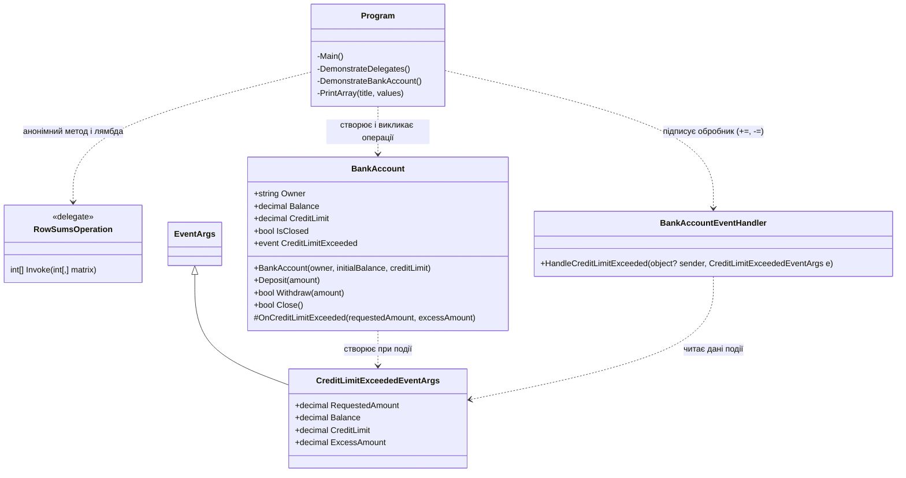
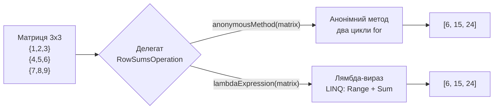
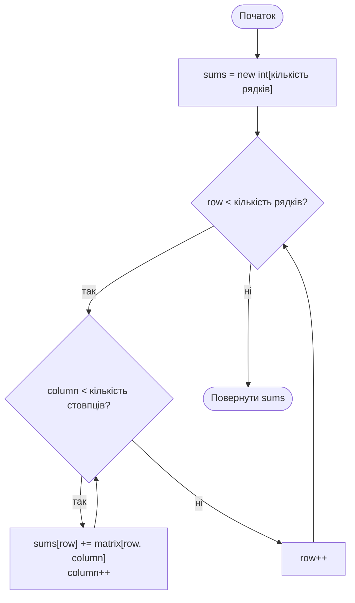
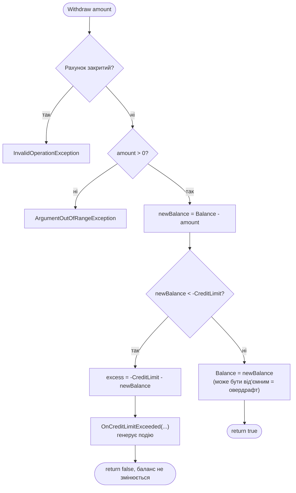
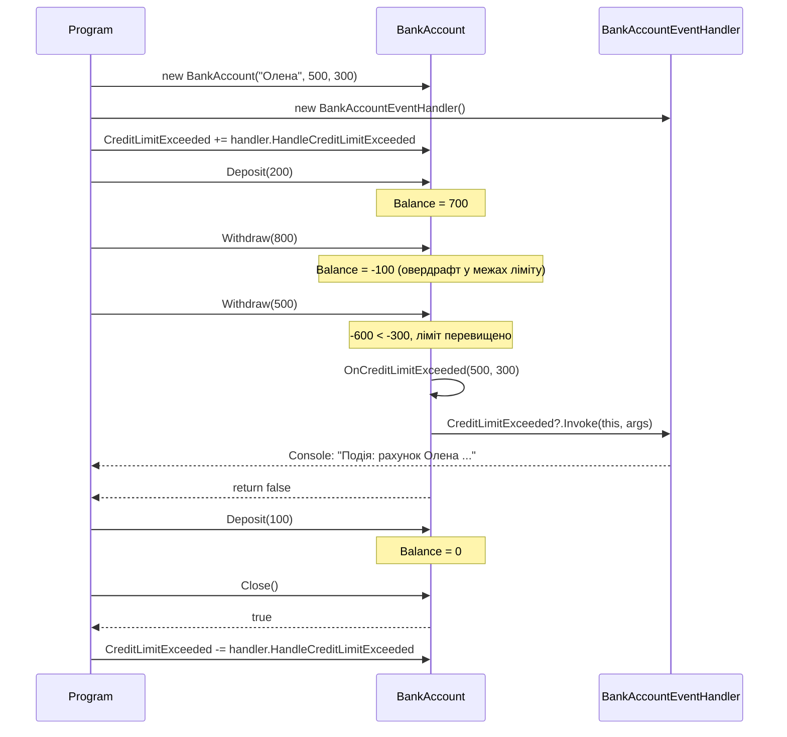
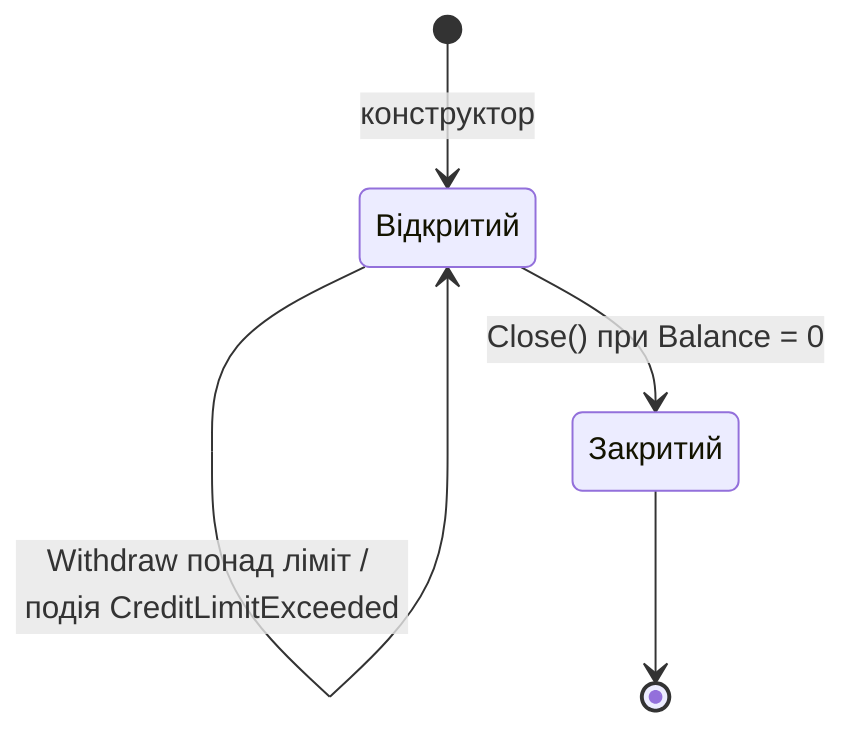

# Схеми роботи програми 

## 1. Діаграма класів

## 2. Частина 1: делегат, анонімний метод і лямбда-вираз

Алгоритм обчислення сум рядків (анонімний метод):

## 3. Частина 2: метод Withdraw і генерування події

## 4. Взаємодія об'єктів під час події

## 5. Стани банківського рахунку

