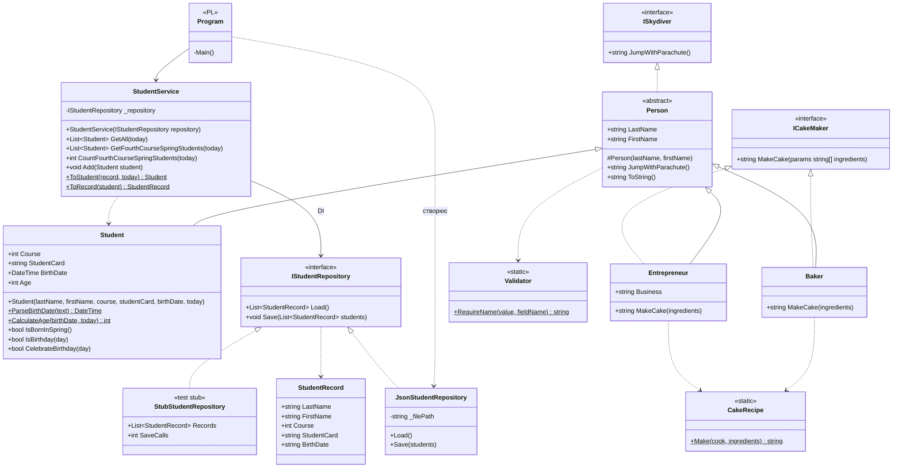
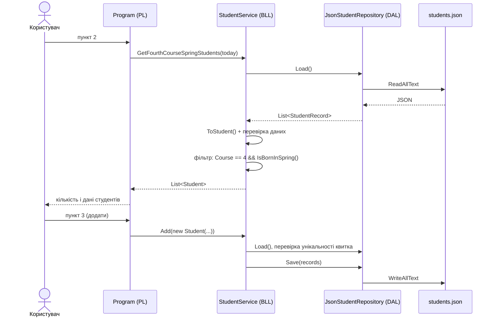
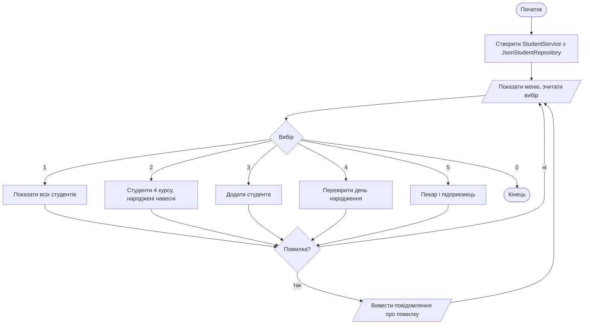
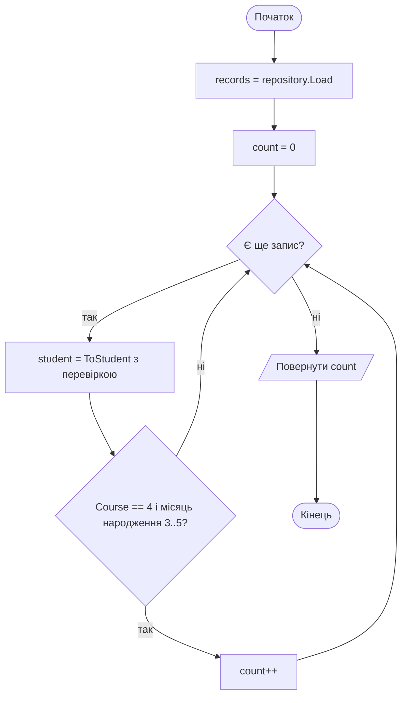
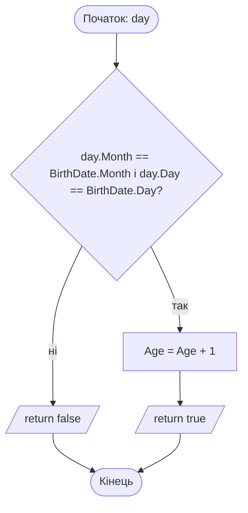
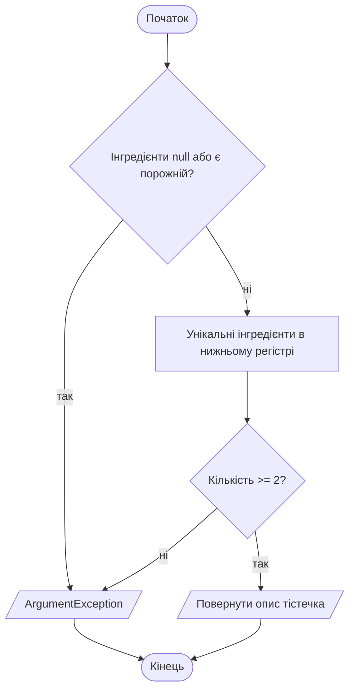

# Lab 5 — Схеми роботи програми

## 1. Діаграма класів

Рівні:
- **PL** (`Lab5.PL`) — консольне меню `Program`.
- **BLL** (`Lab5.BLL`) — `Student`, `Baker`, `Entrepreneur`, `StudentService`, перевірка даних.
- **DAL** (`Lab5.DAL`) — `StudentRecord`, `IStudentRepository`, `JsonStudentRepository` (JSON-серіалізація).
- **Tests** (`Lab5.Tests`) — MSTest, заглушка `StubStudentRepository` підставляється через DI.

## 2. Схема роботи програми

## 3. Блок-схеми

### 3.1 Головне меню

### 3.2 Підрахунок студентів 4-го курсу, народжених навесні

### 3.3 Збільшення віку в день народження (`CelebrateBirthday`)

### 3.4 Приготування тістечка (`CakeRecipe.Make`)

