# UML-діаграми

Джерела — файли `.mmd` (Mermaid) у [uml/](uml/); GitHub рендерить їх прямо в цьому файлі. PNG для звіту лежать поруч.

## Моделі предметної області

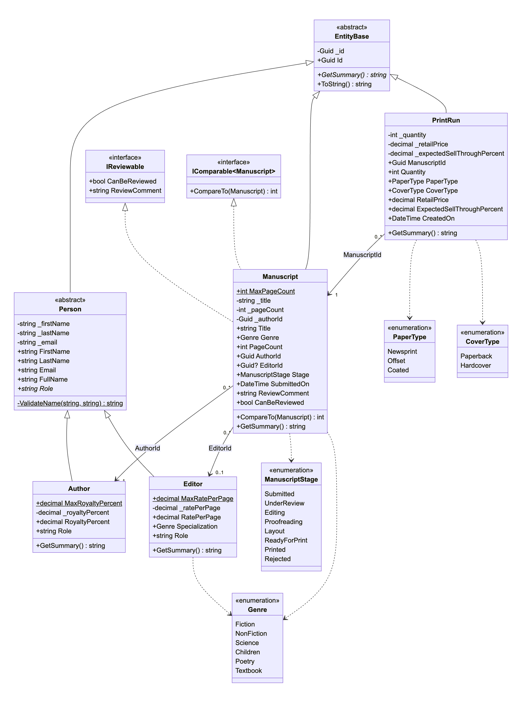

Код Mermaid

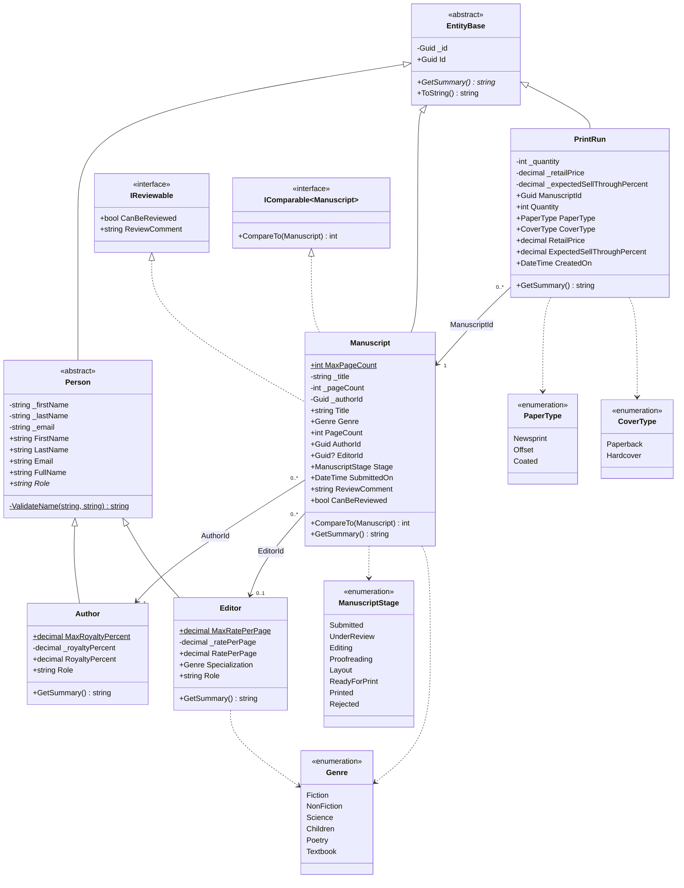

## Сервіси, репозиторії, компаратори

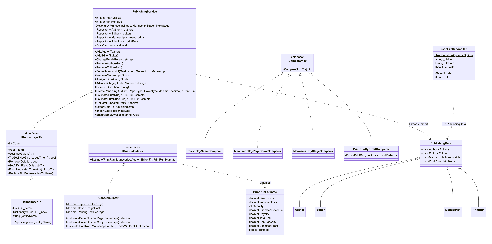

Код Mermaid

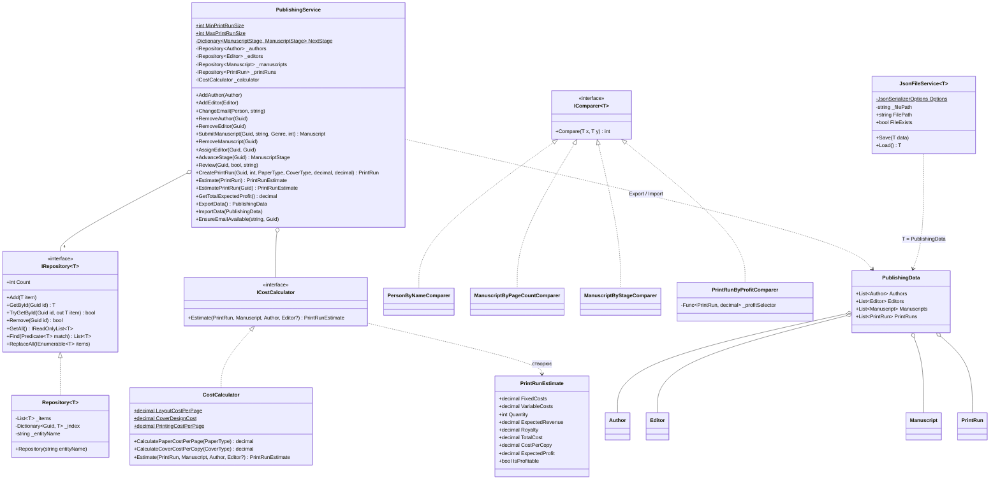

## Ієрархія власних виключень

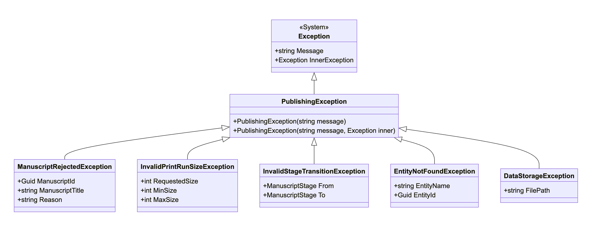

Код Mermaid

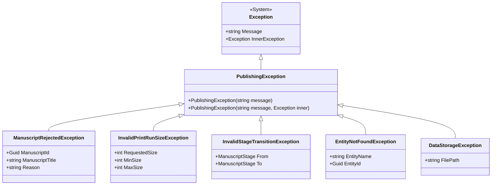

## Інтерфейсна частина (UI)

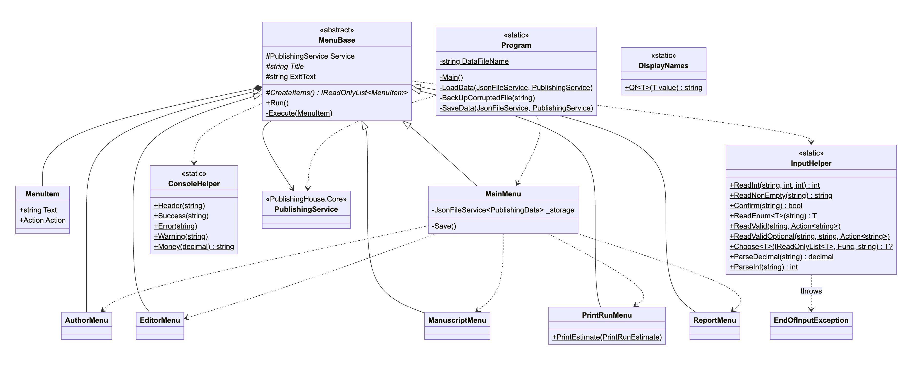

Код Mermaid

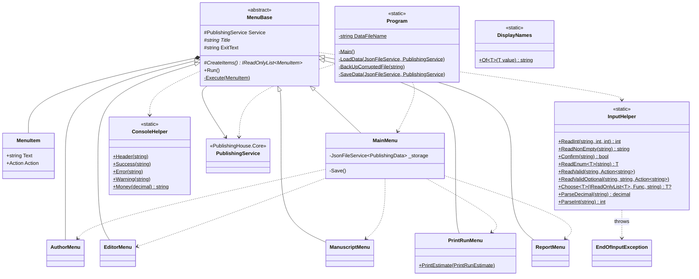

## Діаграма станів рукопису

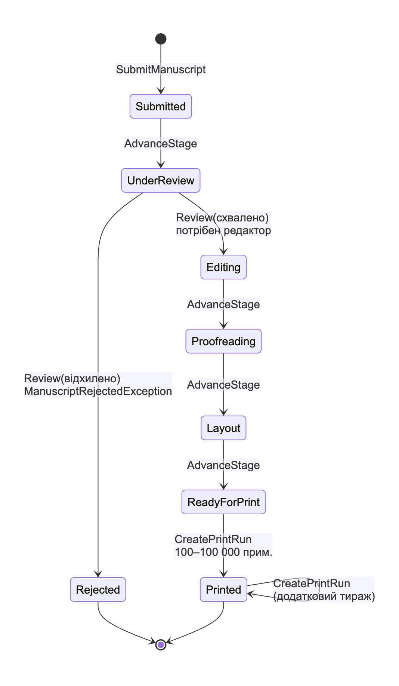

Код Mermaid

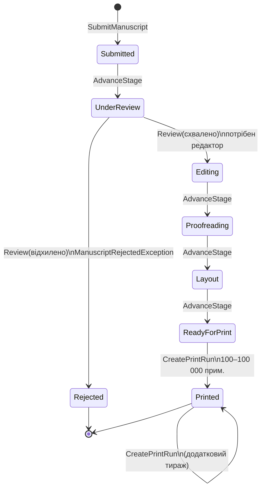

## Компоненти рішення

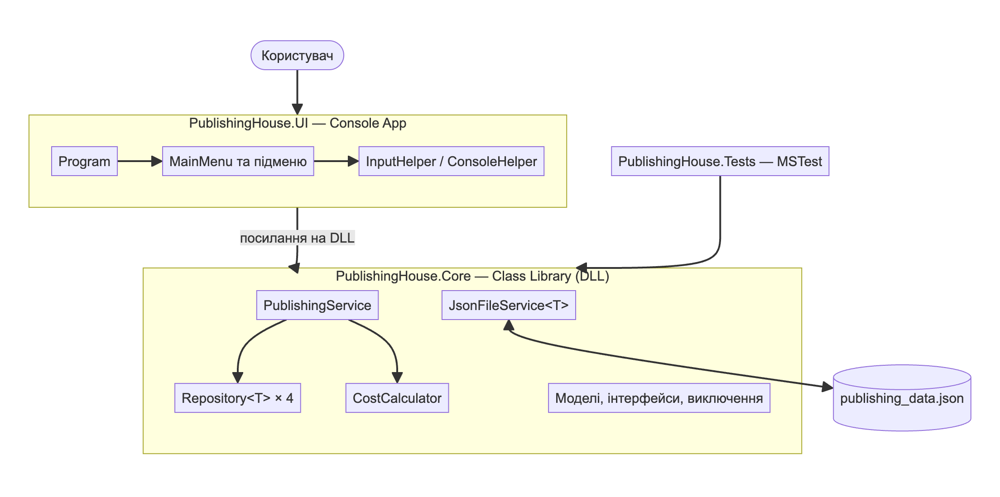

Код Mermaid

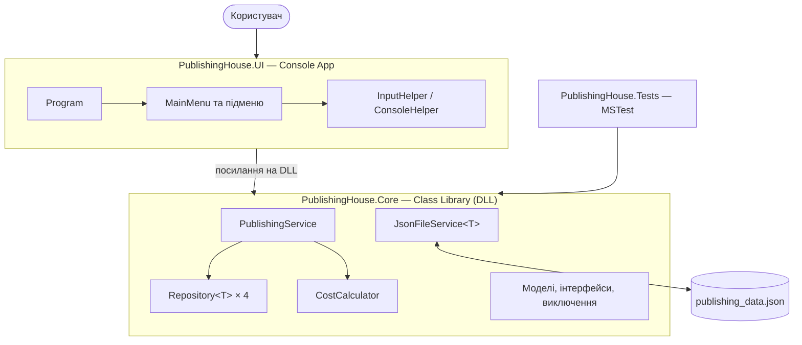

